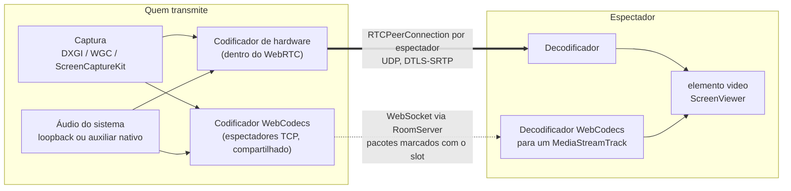
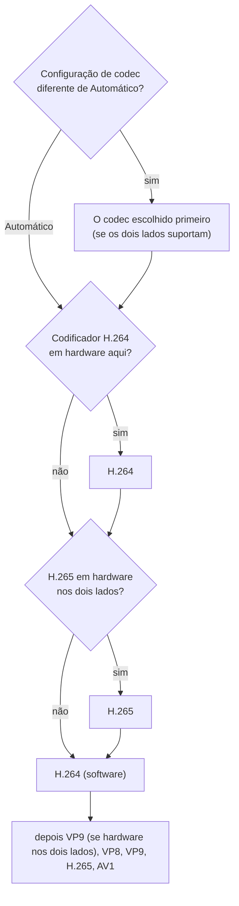
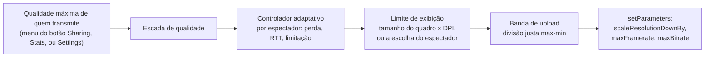
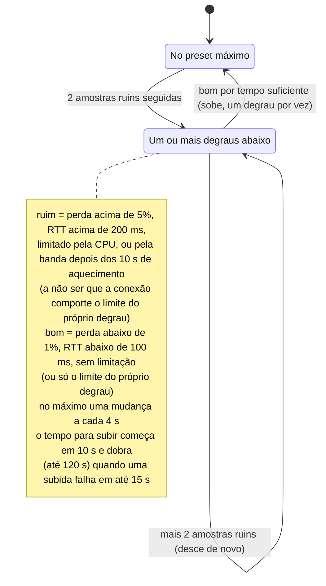
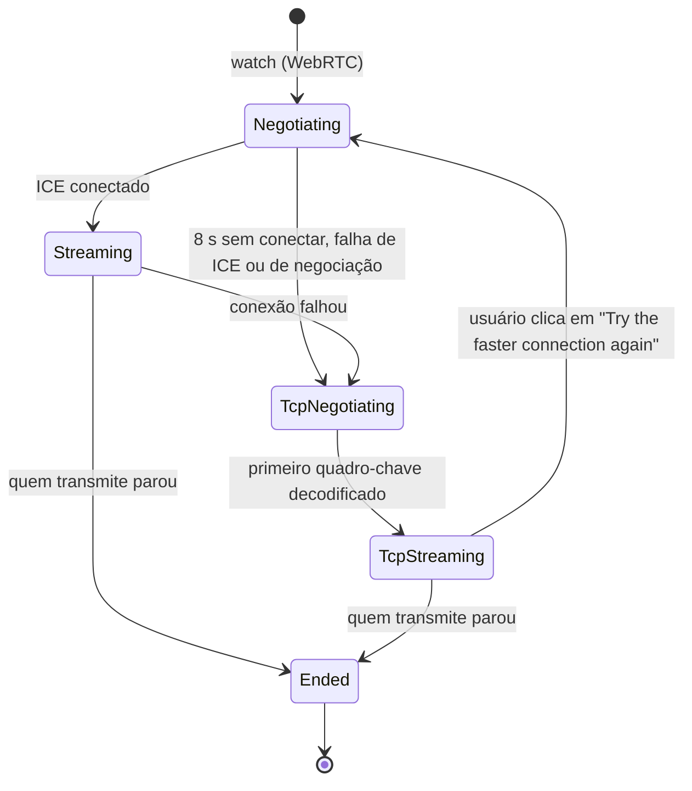
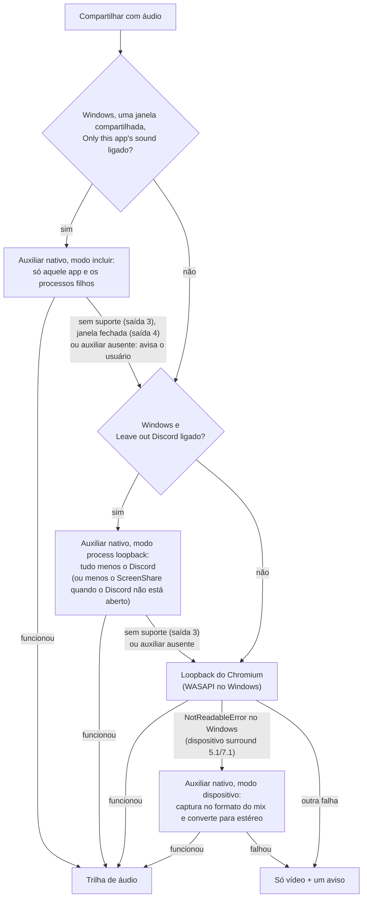

# Pipeline de mídia

Como uma tela vai de um computador para outro: captura, codificação, os dois transportes, controle de qualidade, áudio, prévias e estatísticas. Leia antes a [arquitetura](architecture.md) para ter a visão geral.

> **Idioma:** [English](../en-US/media-pipeline.md) · Português (Brasil)

## Conteúdo

- [Visão geral](#visão-geral)
- [Captura](#captura)
- [Escolha do codec](#escolha-do-codec)
- [Caminho WebRTC](#caminho-webrtc)
- [Controle de qualidade](#controle-de-qualidade)
- [Fallback TCP](#fallback-tcp)
- [Áudio do sistema](#áudio-do-sistema)
- [Prévias](#prévias)
- [Estatísticas e latência](#estatísticas-e-latência)
- [Resultados medidos](#resultados-medidos)

## Visão geral

Quem transmite captura **uma vez** e distribui para todos os espectadores. No caminho WebRTC cada espectador tem seu próprio `RTCPeerConnection` (com suas configurações de codificação, controle de congestionamento e qualidade adaptativa). No caminho TCP, um único codificador WebCodecs atende todos os espectadores TCP daquela pessoa.

## Captura

- O app mostra o próprio seletor de fonte (`SourcePicker.tsx`, alimentado por `window.api.capture.listSources()`) e depois chama `navigator.mediaDevices.getDisplayMedia()`. O processo principal responde a essa chamada com a fonte escolhida via `session.setDisplayMediaRequestHandler` (`src/main/screenCapture.ts`), então nenhuma janela do sistema aparece.
- O Chromium usa as APIs nativas de captura:
  - **Windows**: DXGI Desktop Duplication para telas, Windows.Graphics.Capture para janelas.
  - **macOS**: ScreenCaptureKit (o app pede a permissão de Gravação de Tela).
- Os quadros ficam na GPU e vão direto para o codificador de hardware.
- As restrições de captura vêm da **qualidade máxima** de quem transmite (taxa de quadros, e um limite de altura se não for "Native"). Mudar durante a transmissão chama `applyConstraints()` na trilha ao vivo, sem reconectar.
- O `contentHint` é `motion` (manter a taxa de quadros) ou `detail` (manter o texto nítido), conforme **Settings → Optimize for**. Ele também define o `degradationPreference` do codificador (`maintain-framerate` / `maintain-resolution`) para quando faltar banda ou codificador. **Automatic** (o padrão) escolhe pelo que está na frente, usando o auxiliar de primeiro plano do Windows (`useAutoContentHint`, `autoContentHint` em `src/shared/quality.ts`): `motion` enquanto uma janela em tela cheia (um jogo, um vídeo) está na frente na tela compartilhada, ou enquanto a janela compartilhada está ela mesma em tela cheia na frente; `detail` no resto. Ele espera 1 s para as coisas se acalmarem (alt-tab) e muda a trilha e as codificações ao vivo, sem reconectar. Sem o auxiliar (macOS, Linux), Automatic quer dizer `motion`, o padrão antigo. O painel Stats mostra qual está em uso.

### Jogos que escondem o cursor (Windows)

No Windows anterior ao 11 24H2, o Chromium captura uma **tela** com o DXGI e desenha o cursor do mouse nos quadros ele mesmo (o compositor de cursor do WebRTC). Quando um app esconde o cursor depois que a captura começou, ele continua desenhando a última seta, então os espectadores veem um cursor em cima de um jogo que o esconde, parado no meio nos jogos que o recentralizam. A captura de **janela** (Windows.Graphics.Capture) deixa o próprio Windows desenhar o estado real do cursor e não tem esse problema. O Chromium só a usa para telas inteiras a partir do 11 24H2, uma verificação de versão que o app não consegue mudar.

Por isso, enquanto uma tela é compartilhada num sistema afetado:

1. O `src/main/cursorWatch.ts` roda o `native/win-cursor-watch`, que consulta o `GetCursorInfo` e a janela em primeiro plano a cada 250 ms e imprime uma linha quando algo muda: se está escondido, a janela, se ela cobre o monitor inteiro e qual é o monitor.
2. O `GameCursorGuard` (`src/renderer/lib/gameCursor.ts`) age a partir disso. Quando uma janela em **tela cheia** na tela compartilhada mantém o cursor escondido por 1 s, ele chama `Publisher.switchVideo()` para compartilhar essa janela no lugar da tela: só o vídeo, o áudio continua igual, e a imagem é a mesma, sem o cursor. Quando outra janela fica na frente por 0,4 s (alt-tab), ele volta. Se o jogo fecha, a trilha da janela termina e o publisher volta para a tela escolhida (`chosenSourceId`) em vez de parar.
3. Para um jogo em **janela**, ele só sugere compartilhar a janela, já que isso mudaria o que os espectadores veem.

A sala mostra um aviso enquanto a janela de um jogo é compartilhada, com um botão para manter a tela para aquele jogo. No Windows 10, a captura de janela desenha uma borda amarela em volta do jogo na tela de quem transmite (não na transmissão).

## Escolha do codec

Ao iniciar, o renderer pergunta ao `MediaCapabilities` quais codecs podem ser **codificados** e **decodificados**, e se cada um é `powerEfficient` (um bom sinal de suporte em hardware). Cada participante envia sua lista de decodificadores no `hello`, e quem transmite a recebe no `watch-request`.

`chooseCodecOrder()` (`src/shared/codecs.ts`) ordena os codecs para cada espectador:

Um codec que o espectador não consegue decodificar nunca é oferecido. A tela de configurações mostra o suporte detectado para codificar e decodificar.

## Caminho WebRTC

`Publisher.connect()` (`src/renderer/lib/publisher.ts`), para cada espectador:

1. Cria um `RTCPeerConnection` **sem servidores ICE** (só rede local), com `max-bundle` e `rtcp-mux`.
2. Adiciona a trilha de vídeo com `priority: high` e uma codificação inicial vinda do preset adaptativo.
3. Sempre adiciona um transceiver de áudio, então silenciar ou trocar de fonte só troca a trilha. **Áudio e vídeo não são sincronizados**: o vídeo pertence a dois streams (o do compartilhamento e um de áudio) e o áudio só ao segundo, e os espectadores sincronizam trilhas pelo primeiro stream delas. Sincronizado, o WebRTC segurava a imagem ~1,4 s por um som que chegava em ~100 ms (veja [som e imagem](#som-e-imagem-241)); agora o som chega alguns centésimos de segundo depois da imagem. Apps anteriores ao 2.5.0 trocam para o stream da última trilha que recebem, a do áudio, que leva as duas trilhas.
4. Aplica a ordem de codecs, cria a oferta e envia pelo servidor.
5. Quando a resposta chega, aumenta as dicas de bitrate inicial/mínimo do WebRTC (`mungeBitrates`) para uma transmissão na rede local chegar à qualidade total em um ou dois segundos, e ajusta o Opus para música (`mungeOpus`: estéreo, média de 128 kbps, FEC embutido, sem DTX).

O Chromium é iniciado com flags importantes aqui (`src/main/index.ts`): candidatos ICE com o IP real em vez de nomes mDNS (que não resolvem através de VPNs), envio e recebimento de H.265 permitidos, nada de reduzir o ritmo de uma janela minimizada, **envio mais rápido de quadros grandes** e, com **Menor atraso** (Configurações → Avançado, lido ao abrir), atraso de reprodução zero (`WebRTC-ForcePlayoutDelay/min_ms:0,max_ms:0/`, `src/main/fieldTrials.ts`): o espectador mostra cada quadro assim que é decodificado em vez de suavizar a variação da rede, de 54 para 29–33 ms de tela a tela numa rede local cabeada.

### Quadros-chave sem travadas

O WebRTC envia um quadro-chave a cada 3000 quadros mesmo sem ninguém pedir (`keyFrameInterval`), uns 52 s a 58 fps. Ele cadencia os pacotes num múltiplo da sua taxa alvo: 1,0× para conteúdo de tela (a dica "detail", uma área de trabalho) e 1,1× para vídeo ("motion", um jogo). Um quadro-chave de uma área de trabalho detalhada em 1080p (100–700 KB) levava então 0,2–0,9 s para chegar, e a imagem de todos os espectadores travava nesse meio-tempo, uma vez por minuto. O app inicia o Chromium com `--force-fieldtrials=WebRTC-ProbingScreenshareBwe/10.0,2875,80,40,-60,3/WebRTC-Video-Pacing/factor:10.0/`, que cadencia os dois tipos a 10×: os mesmos quadros-chave chegam sem travar. Só rajadas curtas vão mais rápido; a taxa média não muda. Um `--force-fieldtrials` na linha de comando substitui esse (para experimentos com `npm run perf`).

## Controle de qualidade

Quatro limites independentes decidem o que cada espectador recebe. Eles são combinados em `Publisher.rebalance()` e aplicados com `RTCRtpSender.setParameters()` (sem renegociar).

### 1. A escada e o controlador adaptativo

Presets (`QUALITY_PRESETS` em `src/shared/quality.ts`):

| Preset | Resolução | FPS | Bitrate máximo |
|---|---|---|---|
| Native60 | a da fonte | 60 | 20 Mbps |
| 1080p60 | 1080p | 60 | 15 Mbps |
| 720p60 | 720p | 60 | 10 Mbps |
| 720p30 | 720p | 30 | 5 Mbps |
| 480p30 | 480p | 30 | 2,5 Mbps |

A escada começa no máximo de quem transmite e vai descendo. A cada segundo, `AdaptiveController.update()` lê a perda de pacotes, o RTT e o `qualityLimitationReason` do WebRTC de cada espectador:

Desligar **Adaptive quality** mantém cada espectador no preset máximo.

**O próprio limite não é a rede.** O WebRTC diz "limitado por banda" sempre que o codificador não alcança a qualidade que quer dentro do bitrate máximo, e conteúdo detalhado num degrau baixo sempre bate no limite desse degrau. Contado como rede, isso prendia o controle no degrau mais baixo para sempre (medido: 480p30 no codificador por software, um quadro-chave por segundo, com 16 Mbps disponíveis). Então "limitado por banda" só conta como ruim enquanto a estimativa da conexão (`availableOutgoingBitrate`) está abaixo do limite da codificação, e como bom no caso contrário (`limitedByOwnCap`).

**Aquecendo uma conexão.** A estimativa de banda de uma conexão nova começa em ~3 Mbps. Mantendo a resolução (*Texto nítido*), o codificador descarta quadros para caber; a conexão passa a levar pouco, o WebRTC a vê como limitada pelo app e não pela rede e não aumenta a estimativa, e o espectador pode ficar em ~8 fps para sempre (medido, aleatório por conexão; aconteceu também com o ritmo de envio padrão do WebRTC). Mantendo a taxa de quadros ela enche e a estimativa cresce (11 Mbps em 12 s em 3 de 3 execuções). Então o `RampGuard` (`src/shared/quality.ts`) faz cada conexão manter a taxa de quadros (`maintain-framerate`) até a estimativa cobrir o limite da codificação, por no máximo 20 s, e de novo se depois ela cair abaixo da metade da taxa de quadros sem motivo informado enquanto a estimativa está abaixo do limite. Com os dois: conteúdo detalhado, qualidade adaptativa ligada, 2 espectadores, medido desde o primeiro segundo, 57 fps (p5 56–57) e nenhuma travada em 6 de 6 conexões, em 720p/540p nos primeiros ~25 s e 1080p a partir de ~30 s. Não vale para uma janela compartilhada (`degradationFor`): reduzida, o tamanho ímpar de uma janela (ex.: 1586×892 → 1188×669) faz os codificadores por hardware da NVIDIA falharem, e o WebRTC passa a codificar por software pelo resto da sessão (a 2.5.0 caía para 11–27 fps assim). Janelas mantêm a resolução desde o início: 57 fps com 2 espectadores, sem problema de aquecimento medido.

As mesmas amostras por espectador alimentam o `StruggleDetector` (`src/shared/struggle.ts`), que diz a quem transmite *por que* a qualidade cai: **cpu** (o WebRTC relata limitação de CPU, ou codificar leva mais que o tempo de um quadro), **bandwidth** (todos os espectadores visíveis estão limitados por banda, então é o nosso upload e não o Wi-Fi de um espectador) ou **encoders** (alguns espectadores ganharam um codificador de hardware e outros um de software: a GPU ficou sem sessões de codificação). Uma condição precisa valer em 8 dos últimos 10 segundos; cada tipo aparece no máximo uma vez a cada 10 minutos, e o aviso some quando a condição deixa de valer. Espectadores ocultos ficam de fora.

### 2. Limite de exibição (só enviar o que aparece)

O `ScreenViewer` de cada espectador mede a altura em que realmente exibe a transmissão (altura do quadro × `devicePixelRatio`) e arredonda **para cima** para um degrau: 360, 480, 720, 1080, 1440 ou 2160 (`viewHeightStep`). Só as mudanças de degrau são enviadas (`view-size`).

O espectador também pode escolher uma **qualidade** no menu do quadro (`WATCH_QUALITIES`): Auto, 1080p, 720p, 720p·30, 480p·30, 360p·30. A altura enviada é a menor entre o degrau exibido e a escolha (`watchLimit`), mais um limite de fps nas opções de 30 fps.

Do lado de quem transmite, `limitPreset()` reduz o preset para essa altura e fps e ajusta o bitrate pela quantidade de pixels e pela taxa de quadros. Exemplo: um preset 1080p60 exibido num quadro de 360p custa cerca de 15 Mbps / 9 ≈ 1,7 Mbps.

**Transmissões que ninguém consegue ver não recebem vídeo.** Quando um espectador não consegue ver uma transmissão (a janela dele está minimizada, ou a transmissão está na faixa do destaque e ele escondeu a faixa), a `Subscription` envia `HIDDEN_VIEW` no lugar: 90 px a 1 fps, a menor exibição que o servidor aceita. Nenhum quadro de verdade informa isso (o menor degrau é 360), então quem transmite reconhece o valor (`isHiddenView`) e deixa a codificação de vídeo daquele espectador com `active: false`: nada é codificado nem enviado, e o espectador não precisa de uma parte da banda de upload. O áudio é um envio separado e continua tocando. Quando o espectador volta a ver a transmissão, ele informa a exibição real e o vídeo volta em menos de um segundo. A lista de pessoas de quem transmite mostra "not looking (video paused)". Quem transmite com uma versão antiga, que não conhece essa convenção, envia uma imagem minúscula de 160×90 a 1 fps, então não foi preciso mudar o protocolo.

O mesmo vale no [fallback TCP](#fallback-tcp). O servidor da sala vê o `view-size` de cada espectador: ele não repassa vídeo a um espectador TCP que não consegue ver a transmissão (o áudio continua, e os pacotes pulados não contam como descartados), e quando o espectador volta a ver, pede um quadro-chave a quem transmite e repassa o vídeo a partir dele. O único codificador TCP de quem transmite só atende os espectadores TCP que conseguem ver a transmissão (`tcpViewLimit`) e, quando nenhum consegue, para de codificar até que um consiga, recomeçando com um quadro-chave. Apps antigos na sala se comportam como antes; quem pula os pacotes é o servidor de quem hospeda.

A minimização é informada pelo processo principal (`window:state`); a própria página não consegue saber, porque o app desliga a limitação em segundo plano para a captura e a codificação continuarem rodando. Uma janela que só está *coberta* (por exemplo por um jogo em tela cheia na mesma tela) ainda não é detectada.

### 3. Banda de upload

**Settings → Upload limit when sharing** (padrão 100 Mbps, ou ilimitado) é o upload **total** de quem transmite. `splitBudget()` divide essa banda de forma justa (max-min, "enchendo os copos"): quem precisa de pouco (quadros pequenos) recebe o que precisa, e o resto é dividido entre as visualizações maiores. Os espectadores TCP contam como uma única demanda. Vale na hora, inclusive durante a transmissão.

### 4. Mudanças ao vivo

- Quem transmite muda o máximo: a captura é ajustada, o controlador de cada espectador recomeça na nova escada, o codificador TCP acompanha.
- O espectador redimensiona, coloca em destaque, vai para tela cheia ou escolhe uma qualidade: novo `view-size`, aplicado em menos de um segundo.
- Um espectador entra ou sai: a banda é dividida de novo.

## Fallback TCP

(Diagrama simplificado; no código o `SubscriptionState` é `idle | negotiating | streaming | failed | ended`, com um campo `transport` separado.)

Como funciona (`src/renderer/lib/tcpStream.ts`):

- **Quem transmite**: o `TcpEncoder` lê os quadros com `MediaStreamTrackProcessor` e codifica com o `VideoEncoder` do WebCodecs (tenta H.264 Baseline e High, depois VP9, depois VP8, primeiro em hardware; `latencyMode: realtime`). Quadro-chave a cada 4 s ou quando pedido. O áudio usa o `TcpAudioEncoder` (Opus). Um codificador atende todos os espectadores TCP; ele é dimensionado para o mais exigente dos que conseguem ver a transmissão (`tcpViewLimit`), fica parado quando nenhum consegue, e recebe uma parte da banda de upload.
- **Latência em primeiro lugar**: quadros são pulados quando a fila do codificador ou o buffer do socket local (4 MB) fica para trás, e o próximo quadro é um quadro-chave.
- **Servidor**: marca cada pacote com o slot de quem transmite, deixa no máximo 2 MB na fila de cada espectador e descarta o vídeo até o próximo quadro-chave quando um espectador fica para trás (veja [protocolo → fallback TCP](protocol.md#fallback-tcp)).
- **Retorno**: a cada 2 s o servidor envia `tcp-feedback {sent, dropped}`, que alimenta o controlador adaptativo do próprio codificador TCP.
- **Espectador**: o `TcpDecoder` decodifica com WebCodecs (em hardware quando o computador tem um decodificador para o codec, em software caso contrário) para um `MediaStreamTrackGenerator`, então o mesmo elemento `<video>` exibe os dois transportes.

## Áudio do sistema

O compartilhamento pode incluir tudo que o computador toca. O áudio vai como uma segunda trilha no mesmo stream (WebRTC) ou como pacotes Opus (TCP). O processamento de voz fica desligado (sem cancelamento de eco, supressão de ruído ou ganho automático), porque é áudio do sistema, não um microfone.

### O auxiliar do macOS (`native/mac-audio-capture`)

No macOS, a captura de loopback do Chromium não funciona: a faixa de áudio já chega encerrada, então a transmissão ficava sem som e sem erro. O `getAudioTracks()` ainda devolvia uma faixa, por isso o log dizia "+ audio". Em vez disso, o `publisher.ts` inicia um pequeno auxiliar em Swift (o `scripts/build-native.cjs` o compila com o `swiftc` num binário universal, e o electron-builder o inclui nos recursos do app). Ele abre um stream do ScreenCaptureKit da tela principal com áudio ligado (a imagem tem 2×2 pixels, uma vez por segundo, só porque um stream precisa de uma) e escreve o som no mesmo formato do auxiliar do Windows abaixo: cabeçalho `"SSA1"`, depois frames float32 estéreo intercalados a 48 kHz. Ele tem duas formas de capturar:

| Modo | Argumentos | Como |
|---|---|---|
| Tudo | (nenhum) | O stream do ScreenCaptureKit acima. macOS 13+, permissão de Gravação de Tela. |
| Tudo menos o Discord | `--exclude-bundle-prefix com.hnc.Discord --fallback-pid <pid do ScreenShare>` | Um **process tap** do Core Audio (`CATapDescription(stereoGlobalTapButExcludeProcesses:)`) que deixa de fora todo processo de áudio cujo bundle id começa com o prefixo, o que cobre o Discord, o Discord PTB/Canary e todos os processos auxiliares deles (`com.hnc.Discord.helper…`). Enquanto nenhum deles toca som, deixa de fora os processos do próprio ScreenShare, como o auxiliar do Windows. A lista é reconferida a cada segundo, então o Discord entrando numa chamada depois de a transmissão começar fica de fora em cerca de um segundo. macOS 14.2+ e a permissão de *Gravação de Áudio do Sistema* (um segundo pedido). |

O tap é necessário porque o ScreenCaptureKit só deixa de fora *apps* inteiros, e o som dos apps Chromium/Electron (o Discord é um) vem dos processos auxiliares deles, que ele não atribui ao app: medido com um app Electron tocando um tom, excluir o app desse jeito deixou o tom em volume total, e o tap o silenciou.

Quando o tap não pode ser usado (macOS antigo, ou a permissão foi negada), o `publisher.ts` inicia o primeiro modo e o usuário é avisado de que o Discord não ficou de fora (`audio.discordNotExcluded`). Códigos de saída: `2` a captura parou sozinha, `3` macOS antigo demais para o modo pedido, `5` não conseguiu iniciar (a Gravação de Tela, ou a Gravação de Áudio do Sistema no caso do tap, não está liberada). Como no auxiliar do Windows, tudo o que pode falhar é preparado primeiro, depois o cabeçalho é escrito, e só então a captura começa, com toda escrita no stdout passando por um único bloqueio, então o cabeçalho é sempre a primeira coisa que o app lê. Não há modo por app.

### O auxiliar do Windows (`native/win-audio-capture`)

Um pequeno programa em C#, compilado com o compilador C# que vem com o .NET Framework 4 em todo Windows 10/11 (`scripts/build-native.cjs`, executado automaticamente antes do `dev` e do `build`). O processo principal o executa (`src/main/nativeAudio.ts`) e repassa a saída para o renderer, que a transforma num `MediaStreamTrack` (`src/renderer/lib/nativeAudio.ts`).

| Modo | Argumentos | Como |
|---|---|---|
| Loopback do dispositivo | (nenhum) | Loopback WASAPI do dispositivo de saída padrão no formato do próprio mix (funciona com headsets 5.1/7.1), convertido para estéreo: centro e surrounds a −3 dB, LFE descartado. |
| Só um app | `--include-window <HWND>` | Process loopback no modo *incluir a árvore de processos alvo*, para o app dono da janela compartilhada (`GetWindowThreadProcessId`): esse processo e os processos filhos, o que cobre navegadores e jogos que tocam o som a partir de um processo auxiliar. Usado quando uma única janela é compartilhada com **Only this app's sound** (ligado por padrão). |
| Tudo menos um app | `--exclude Discord.exe,DiscordPTB.exe,DiscordCanary.exe,DiscordDevelopment.exe --fallback-pid <pid do ScreenShare>` | **Process loopback** do Windows (Windows 10 2004+ / 11) no modo *excluir a árvore de processos alvo*. Encontra o processo raiz do Discord (a maior árvore) e procura de novo a cada 2 s, então o Discord pode abrir, fechar ou reiniciar durante a transmissão. Enquanto o Discord não está aberto, deixa de fora o próprio ScreenShare. O Windows converte para 48 kHz estéreo. |

Saída no stdout: um cabeçalho de 10 bytes `"SSA1"` + taxa de amostragem u32 + canais u16 (sempre 2), e depois quadros estéreo float32 intercalados. Envia silêncio de verdade quando nada está tocando, para manter o ritmo estável. Códigos de saída: `1` erro fatal, `2` dispositivo invalidado, `3` process loopback indisponível, `4` a janela a incluir foi fechada (os dois antes do cabeçalho). Ele termina quando o stdin é fechado.

Limitações: o process loopback só consegue deixar de fora **um** app por vez, e deixa de fora *todo* o som do Discord (notificações e soundboard também). *Só um app* segue a árvore de processos do dono da janela: um app cujo som vem de um processo fora dessa árvore (alguns jogos abertos por um launcher, apps hospedados pelo `ApplicationFrameHost.exe`) é capturado em silêncio, por isso a opção pode ser desligada no diálogo de compartilhar.

## Prévias

A cada minuto (e 1,2 s depois de começar, trocar de fonte ou retomar) quem transmite captura um quadro, reduz para 320 px de largura e envia como data URL JPEG (`snapshot`). O servidor confere se quem enviou está compartilhando, o tipo e o tamanho, limita a taxa, guarda a última para quem entrar depois e apaga quando a transmissão termina. Os espectadores veem as prévias no quadro de quem transmite e ao passar o mouse sobre a pessoa na coluna de salas. Quem transmite guarda a própria prévia localmente para o próprio quadro.

## Estatísticas e latência

- **Quem transmite** (`Publisher.collectStats`, a cada segundo): por espectador, bitrate, fps, RTT, perda, tempo de codificação, implementação do codificador, codec e limitação de qualidade. Aparece no painel Stats e na sobreposição do próprio quadro, e é enviado aos espectadores como `publisher-stats` (tempo de codificação).
- **Espectador** (`Subscription`, a cada segundo, enviado a cada 2 s): fps, resolução, bitrate, perda, codec, decodificador, quadros descartados, bitrate do áudio, transporte e uma medida de latência.
- **A latência no WebRTC é uma estimativa**: captura + codificação + ½ RTT + buffer de jitter + decodificação + exibição. Ela fica uns 23 ms abaixo do real: veja [atraso de tela a tela](#atraso-de-tela-a-tela-241). No caminho TCP ela é medida pelo horário de captura em cada pacote, corrigido pela diferença de relógio para o anfitrião (via `ping`/`pong`).

## Resultados medidos

Windows 10, GPU NVIDIA, todas as instâncias no mesmo computador (rede de loopback), antes das mudanças da v4:

| Cenário | Resultado |
|---|---|
| Uma transmissão, WebRTC | 1920×1080 a 57–58 fps, H.265 via `MediaFoundationVideoEncodeAccelerator (NVIDIA HEVC Encoder MFT)`, codificação de 4,3 ms/quadro, latência estimada de ponta a ponta ~30–65 ms |
| Capacidade do codificador de hardware | 8 codificações 1080p simultâneas em hardware (H.264 e H.265) a ~57 fps cada, ~13 % de CPU total, decodificando 8 transmissões ao mesmo tempo |
| Duas pessoas compartilhando, uma terceira assistindo as duas | As duas em 1080p ~57 fps; as duas também se assistiram ao mesmo tempo |
| Limite de exibição | Dois quadros na grade (≈276 px de altura) → 640×360 cada. Destaque (505 px) → 1280×720. (Medido quando o app ainda tinha zoom: 212 % → 1920×1080.) |
| Banda de upload | O upload de quem transmitia caiu de 6,2–7,5 Mbps para 2,3–3,5 Mbps com um limite de 3 Mbps, aplicado durante a sessão |
| Fallback TCP | Duas transmissões ao mesmo tempo por TCP, cada uma roteada ao seu quadro pelo slot, 57–58 fps, H.264 em hardware via WebCodecs |
| Áudio | Tom de 440 Hz recebido como 439 Hz (WebRTC ~160 kbps, Opus por TCP a 128 kbps); um headset 7.1 pelo auxiliar nativo: 880 Hz recebido como 879 Hz |
| Reconexão | Queda forçada → "Reconnecting…", as duas transmissões assistidas renegociadas em ~45 ms |

A escolha automática de codec ficou com H.265 nessa máquina porque o driver informava a codificação HEVC em hardware como eficiente, mas não a H.264, embora a codificação H.264 em hardware funcionasse quando forçada.

Perda de pacotes real ainda não foi simulada; o controlador adaptativo e a divisão de banda são cobertos por testes unitários.

### Atraso de tela a tela (2.4.1)

Medido com `npm run perf -- --viewers=2 --view-height=1080 --seconds=60 --latency --adaptive=off` no mesmo computador de cima (RTX 4070, Windows 10, tela real em 1080p60 com o padrão de teste), 2 espectadores em 1080p, 60 s, sem áudio, qualidade adaptativa desligada: 1920×1080 a 57 fps pelo codificador HEVC da NVIDIA, sem travadas.

| | p50 | p95 |
|---|---|---|
| Real, de tela a tela (código de tempo) | 54 ms | 59–62 ms |
| A estimativa do app para os mesmos quadros | 31 ms | 34 ms |

A estimativa deixa de fora uns 23 ms: o caminho da captura, os quadros que o navegador do espectador e o Windows guardam antes de mostrar, e o desenho do próprio padrão na tela dele (até uma atualização a 240 Hz). Com a qualidade adaptativa ligada, o mesmo padrão detalhado derrubou a transmissão para o codificador por software a 30 fps (o controle desce quando aparece "limitado por banda", e o limite de bitrate do próprio degrau mais baixo continua causando isso).

### Captura mais rápida (2.5.0)

Dois recursos do Chromium 152 que copiam cada quadro capturado menos vezes, testados no PC com RTX 4070 / Windows 10 (1080p60, 2 espectadores em 1080p, HEVC da NVIDIA). Nenhum é usado:

| Recurso | Resultado |
|---|---|
| `ZeroCopyDesktopCapture` (quadros da tela direto no buffer de captura) | A captura sozinha funciona (57–58 fps), mas os codificadores por hardware da NVIDIA (H.264 e H.265) **travam** com os quadros dele: o compartilhamento para assim que alguém assiste. O VP8 por software continuou funcionando. |
| `WebRtcAllowWgcUsingTexture` (quadros do Windows Graphics Capture mantidos na GPU; janelas no Windows 10, telas só a partir do Windows 11 24H2) | Compartilhando uma janela: 57 fps, codificação 3,3 vs 3,4 ms, CPU do app 5 % nos dois casos. Nenhum ganho mensurável. |

A captura já custa pouco a este computador (CPU do app ~5 % em 1080p60). Vale testar de novo no Windows 11 24H2, onde o segundo também cobre telas inteiras.

### Som e imagem (2.4.1)

Mesmo computador, `--latency --audio --adaptive=off --hint=motion`, 1 espectador em 1080p (57 fps, HEVC da NVIDIA):

| | Imagem, de tela a tela | Som (apitos) |
|---|---|---|
| Áudio e vídeo num fluxo só (2.4.1) | ~1.490 ms | ~102 ms |
| Áudio num fluxo só dele | 50 ms | ~106 ms |
| Atraso de reprodução zero (`WebRTC-ForcePlayoutDelay/min_ms:0,max_ms:0/`) | 29 ms | ~113 ms |

- **Com som, a imagem ficava segurada ~1,4 s.** Áudio e vídeo iam num fluxo só, então o espectador os sincronizava, e o WebRTC achava o áudio ~1,4 s atrás do vídeo, mas ele não estava: o som chegava em ~100 ms (e o buffer de jitter do áudio do espectador ficava em 30 ms). O espectador ouvia tudo ~1,4 s antes de ver. O mesmo com a captura do Chromium e com o auxiliar. Mandar o áudio num fluxo só dele tira a espera.
- **Atraso de reprodução zero** (a renderização de baixa latência do WebRTC: quadros mostrados assim que decodificados) levou transmissões só de vídeo de 54 para 29–33 ms de tela a tela, e o buffer de jitter do espectador de 9 para 1 ms.
- **Uma conexão pode travar em ~8 fps** com conteúdo detalhado e *Texto nítido* (manter a resolução): ela começa com bitrate baixo (~2,5 Mbps), o codificador descarta quadros para caber, e com tão pouco enviado o WebRTC nunca aumenta a estimativa. *Movimento suave* baixa a resolução no lugar e não trava.

### Capacidade de codificação (`npm run perf`, 2.2.0)

Windows 10 (19045), NVIDIA GeForce RTX 4070 (driver 32.0.16.1047), AMD Ryzen 9 7900X, a tela de verdade compartilhada em 1080p60, o streamer e todos os espectadores nesse mesmo computador. Os espectadores pediram 1080p (`--view-height=1080`), menos na primeira linha. Todo espectador recebeu um codificador de hardware: H.265 pelo `MediaFoundationVideoEncodeAccelerator (NVIDIA HEVC Encoder MFT)`.

| Espectadores | Codificadores de hardware | fps no espectador p50 (p5) | Latência p50 / p95 | Codificação p50 / p95 | CPU do app | CPU do computador p50 / p95 |
|---|---|---|---|---|---|---|
| 4, no tamanho do bloco (640×360) | 4 de 4 | 58 (56) | 30–34 / 33–39 ms | 2,9 / 3,4 ms | 5 % | 25 / 31 % |
| 4 | 4 de 4 | 57–58 (55–56) | 52–59 / 85–162 ms | 6,5 / 7,6 ms | 8 % | 23 / 27 % |
| 8 | 8 de 8 | 57–58 (54–56) | 61–82 / 97–132 ms | 11,3 / 14,5 ms | 15 % | 52 / 58 % |
| 9 | 9 de 9 | 57 (48–54) | 75–100 / 106–186 ms | 15 / 26–31 ms | 19 % | 76 / 83–89 % |

- **Essa placa nunca ficou sem codificadores de hardware**, até 9 espectadores, o máximo que uma sala comporta (`MAX_USERS` = 10 pessoas, contando o streamer). Passar espectadores extras para o caminho TCP (Tarefa 4 de `plans/performance.md`) não é necessário nela; placas Intel e AMD ainda precisam ser medidas.
- Os números com 9 espectadores vêm de duas execuções que pararam quando um décimo espectador encontrou a sala cheia, então incluem o aquecimento (30–45 s por espectador).
- O tempo de codificação por quadro cresce com o número de espectadores, já que todos os codificadores dividem a placa, mas o streamer continuou enviando 57–58 fps para todos.
- Com tudo num computador só, a decodificação dos espectadores também pesa: é a maior parte da CPU do computador e do aumento da latência (o jitter buffer dos espectadores foi de ~8 ms para 30–60 ms). Dois computadores (`--host-only` e `--join`) separariam o custo do streamer do dos espectadores.
- Em 1080p, cada espectador travou por 0,4–0,9 s uma ou duas vezes em 90 s, uns 52 s depois do início de cada conexão e de novo 52 s depois, enquanto o streamer enviava 58 fps estáveis sem perda de pacotes. Cada travada era um quadro-chave sendo enviado devagar; resolvido com o [envio mais rápido](#quadros-chave-sem-travadas). Mesmo PC, 2 espectadores em 1080p por 120 s, uma área de trabalho compartilhada:

  | Cadência | Quadros-chave por espectador | Travadas por espectador | Latência p50 / p95 |
  |---|---|---|---|
  | Padrão do WebRTC | 2 | 2 (0,4 s no total) | 32 / 33–35 ms |
  | 10× (padrão do app desde esta mudança) | 2 | 0 | 31 / 32 ms |
